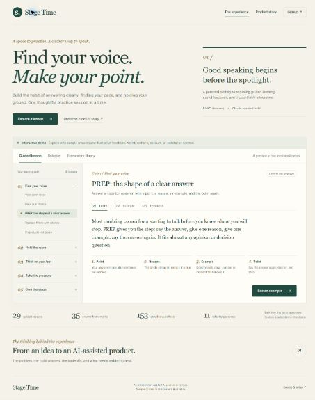

# Stage Time

**An AI-assisted public speaking practice prototype — from BMAD discovery to a Claude-assisted build.**

[Explore the browser demo](https://yazym-dotcom.github.io/stage-time/) · [Read the product story](https://yazym-dotcom.github.io/stage-time/#story) · [Run the local application](docs/LOCAL_SETUP.md)



Stage Time explores a product hypothesis: people who want to communicate more clearly could benefit from structured practice, a shape for their answers, and one useful thing to improve after each attempt.

The local application combines guided lessons, simulated conversations, local speech analysis, and coaching. The browser demo makes the experience easy to explore without installation or microphone access.

## My role and how I used AI

This is an independent product project. I used **BMAD for discovery and brainstorming**, then **Claude to help code the application**. I used the resulting app myself and consider it a working prototype.

The public showcase and repository packaging were subsequently prepared with Codex assistance. AI assistance is disclosed as part of the process; this project does not claim that every line of code was handwritten.

**Current stage:** personally tested prototype. No external users, measured adoption, speaking-improvement results, or business-impact claims yet.

## Explore it in two minutes

1. [Open a guided lesson](https://yazym-dotcom.github.io/stage-time/#lesson): move from teaching to a worked example and illustrative feedback.
2. [Try a roleplay](https://yazym-dotcom.github.io/stage-time/#roleplay): choose a response and see a scripted follow-up.
3. [Browse the framework library](https://yazym-dotcom.github.io/stage-time/#library): search and inspect the original learning content.
4. [Read the product story](https://yazym-dotcom.github.io/stage-time/#story): discovery, AI-assisted development, product tradeoffs, and the next validation step.

The demo uses **fixed, labeled sample feedback and prewritten roleplay branches**. It does not record audio, call an AI model, or assess a visitor. Worked examples may contain fictional figures; these are not project results.

## What the local prototype contains

| Capability | Scope |
| --- | --- |
| Guided learning | 29 lessons across five units |
| Answer frameworks | 35 frameworks with steps, examples, and source attribution |
| Practice questions | 153 questions |
| Roleplay | 11 personas and optional model-generated follow-ups |
| Speaking signals | Pace, fillers, language patterns, and acoustic measurements |
| Local AI | faster-whisper transcription, Ollama coaching, optional Kokoro voices |

These counts describe product content, not user adoption or validated outcomes.

## Product and AI decisions

| Decision in the implementation | Intended value | Tradeoff to examine |
| --- | --- | --- |
| Guided path with free practice alongside it | Give the user a clear next step | Does structure help people return, or feel restrictive? |
| Rules for measurable signals; AI for interpretive feedback | Make parts of the feedback easier to explain | Transcription and model judgments remain fallible |
| Local speech processing and models | Reduce dependence on paid APIs and process speech locally | Installation, downloads, and hardware requirements |
| Fallback behavior when optional services are unavailable | Keep available practice functions usable | Feedback is less complete and must be labeled clearly |

See [the product case study](docs/PRODUCT_CASE_STUDY.md) and [the proposed validation plan](docs/VALIDATION_PLAN.md).

## Architecture

```text
Local application
Browser interface + microphone
             |
       FastAPI backend
        /     |      \
transcription rules   coaching model
  Whisper   scoring     Ollama
        \     |      /
       feedback + local JSON records

Public browser demo (separate)
Static HTML/CSS/JavaScript + exported public curriculum
Curated examples; no backend, microphone, or personal records
```

The local app is designed for **one user on one computer**. It is not an authenticated, multi-user hosted service. Keep the launcher bound to `127.0.0.1`.

## Run the demo locally

No package installation or build step is needed:

```sh
python -m http.server 8765 --directory demo --bind 127.0.0.1
```

Open `http://127.0.0.1:8765`. The demo can also be opened directly using `demo/index.html`.

## Run the full local application

Use Python 3.12 and install ffmpeg, then:

- **Windows:** double-click `start.bat`.
- **macOS/Linux:** run `bash start.sh`.
- **Optional coaching:** install Ollama and run `ollama pull qwen2.5:3b`.

The launchers create an environment outside the project folder. Models can require significant downloads. See [the full setup guide](docs/LOCAL_SETUP.md) for instructions and [technical details](docs/TECHNICAL.md) for the original implementation notes.

## Repository map

| Path | Purpose |
| --- | --- |
| `demo/` | Public browser demo and product story |
| `main.py`, `stage-time.html` | Full local app backend and interface |
| `course.py`, `frameworks.py`, `questions.py`, `content.py` | Learning content |
| `scoring.py`, `text_metrics.py`, `voice_metrics.py` | Feedback and measurement logic |
| `avatars/` | Existing generated character assets for the local app |
| `docs/` | Product case study, validation plan, setup, technical notes, and provenance |
| `scripts/export_demo.py` | Export public curriculum without loading private records or AI models |
| `scripts/check_project.py`, `tests/` | Lightweight checks that need no AI model downloads |

Personal `data/`, caches, credentials, model weights, and source image collections are excluded. No personal recordings or practice history are included.

## Checks and deployment

```sh
python -B scripts/check_project.py
python -B -m unittest discover -s tests
node --check demo/app.js
```

The checks verify source syntax, curriculum integrity, scoring invariants, and the public demo's local references. They do not validate speech-model accuracy or establish user outcomes.

GitHub Pages publishes only `demo/` through the included workflow. If you fork the project, enable **Settings → Pages → Source → GitHub Actions** and update the repository links in the demo and this README.

## Next validation step

Run a small usability pilot: can a new user start practice without help, understand the feedback, and identify a useful change for the next attempt? Use observed friction and follow-up feedback to choose the next iteration.

## Attribution and reuse

Framework sources are retained alongside the learning content. Existing avatar assets are AI-generated. See [provenance and limitations](docs/PROVENANCE.md). This repository is shared for portfolio review; no open-source license is granted at this stage. Dependencies retain their respective licenses.

